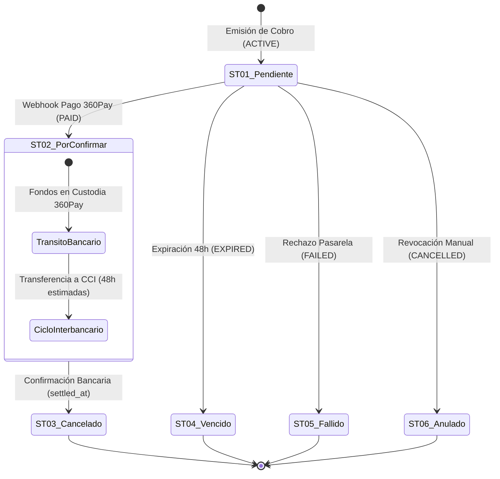

# Arquitectura Integral y Lógica Profunda del Backend de Kuota

> **Documento Técnico de Referencia de Ingeniería**  
> **Versión del Sistema:** v1.1.0-alpha · Monorepo Kuota Android / Backend  
> **Clasificación:** Confidencial / Documentación de Auditoría de Sistemas y Pasarela  
> **Normativas de Cumplimiento:** Ley N° 29733 (Protección de Datos Personales - Perú) · Estándares PCI-DSS v4.0 (Nivel Comercio / Pasarela) · OWASP ASVS 4.0.3

---

## 1. Visión General y Topología de Infraestructura

El backend de **Kuota** es un monolito modular de alto rendimiento diseñado en **Node.js 22 LTS**, tipado estrictamente con **TypeScript 5.x** bajo módulos nativos **ECMAScript (ESM)**. Su arquitectura prioriza el determinismo contable, la resistencia ante ataques criptográficos y la observabilidad forense inmutable.

```mermaid
flowchart TD
    subgraph Clientes["Capa de Clientes & Perímetro"]
        AppAndroid["App Nativa Android (Capacitor/Kotlin)"]
        PayPage["Página de Cobro Web Pública (/pay/:code)"]
        Pasarela360["Pasarela Bancaria 360Pay (Webhooks)"]
        DiditKYC["Servicio Biométrico Didit (KYC Hooks)"]
    end

    subgraph Perimetro["Perímetro de Seguridad (Express + Middlewares)"]
        ProxyTrust["Trust Proxy 1 (Railway / Cloud Run)"]
        SecHeaders["Cabeceras HTTP de Blindaje (CSP, HSTS, No-Sniff)"]
        CORS["CORS Whitelist Dinámica (APK + Orígenes Verificados)"]
        RawBodyVerify["Body Parser con Buffer de Verificación Criptográfica"]
        RateLimiter["Rate Limiter por IP (600 req/min)"]
        VersionGate["Gate de Versión Mínima de APK (KUOTA_MIN_APP_VERSION_CODE)"]
    end

    subgraph CoreBackend["Núcleo del Backend (src/)"]
        AuthModule["Autenticación & Sesión Mono-Dispositivo (CTL-A03)"]
        PricingEngine["Motor de Comisiones (1% + IGV, Piso S/ 4.50)"]
        PaymentLinkSM["Máquina de Estados de Links (ACTIVE/PAID/CANCELLED)"]
        ReconPipeline["Riel de Conciliación & Liquidación (ST-01..ST-04)"]
        LedgerService["Motor de Doble Partida Contable (Balance Neto 0)"]
        AuditWORM["Auditoría Hash Chaining (SHA-256 + HMAC Privado)"]
    end

    subgraph Persistencia["Capa de Persistencia"]
        PGLite["PGLite / PostgreSQL (Transacciones ACID)"]
        AuditAnchors["Tabla de Anclaje Forense (audit_anchors)"]
        WebhookEvents["Tabla Deduplicadora Idempotente (webhook_events)"]
    end

    Clientes --> Perimetro
    Perimetro --> CoreBackend
    CoreBackend --> Persistencia
```



---

## 2. Pipeline de Middlewares y Capa de Blindaje Perimetral

El pipeline de middlewares se inicializa en `backend/src/app.ts` siguiendo una secuencia determinista estricta. Ninguna solicitud llega a los controladores de negocio sin haber superado los 7 filtros perimetrales:

### 2.1 Verificación Temprana de Entorno (`assertProductionEnv`)
Antes de invocar `app.listen()`, la función `assertProductionEnv()` evalúa las variables de entorno. Si el sistema corre con `NODE_ENV=production` y falta cualquiera de los secretos críticos de seguridad, el proceso **aborta inmediatamente** arrojando una excepción fatal:
* `DIDIT_WEBHOOK_SECRET`: Previene que atacantes aprueben verificaciones de identidad arbitrariamente.
* `KUOTA_PLAY_INTEGRITY_KEY`: Valida que las transacciones provengan de un APK legítimo no alterado.
* `KUOTA_CORS_ORIGINS`: Prohíbe el uso de `localhost` en entornos de producción.
* `KUOTA_SANDBOX`: Si está en `1` con pasarela real conectada, detiene el servidor para evitar liquidaciones ficticias sobre dinero real.

### 2.2 Preservación de Cuerpo Crudo (`req.rawBody`)
Para verificar firmas HMAC sin riesgo de desalineación por serialización o espacios en blanco, el parser JSON de Express retiene el buffer exacto transmitido por el emisor:
```typescript
app.use(
  express.json({
    limit: '200kb',
    verify: (req, _res, buf) => {
      (req as Request).rawBody = Buffer.from(buf);
    }
  })
);
```

### 2.3 Gate de Versión Mínima del APK (`KUOTA_MIN_APP_VERSION_CODE`)
Si se detecta un incidente de seguridad o se rotan pines criptográficos en la app móvil, el backend puede activar `KUOTA_MIN_APP_VERSION_CODE`. Cualquier petición de un cliente desactualizado recibe de inmediato:
```json
HTTP/1.1 426 Upgrade Required
{
  "error": {
    "code": "APP_UPDATE_REQUIRED",
    "message": "Actualiza la app de Kuota a la última versión para continuar operando con seguridad.",
    "min_version_code": 14
  }
}
```

---

## 3. Motor Criptográfico, Identidad y Sesión Mono-Dispositivo

### 3.1 Hashing de PIN y Pimienta Criptográfica (Control CTL-A01)
El PIN numérico del comercio (exactamente 6 dígitos válidos verificados por `pinProblem`, rechazando secuencias y fechas) jamás se almacena en texto claro. Se procesa con **`crypto.scryptSync`** (`N=16384, r=8, p=1, keylen=32`) aplicado sobre **`HMAC-SHA256(KUOTA_PIN_PEPPER, pin)`** con sal aleatoria de 16 bytes y comparación en tiempo constante (`crypto.timingSafeEqual`). Incluso ante un volcado de la base de datos, los hashes son matemáticamente invulnerables sin la pimienta del servidor.

### 3.2 Bloqueo Anti-Fuerza Bruta y Enfriamiento (Control CTL-A02 y Device Binding)
* **Límite:** 5 intentos consecutivos erróneos de PIN (`pinMaxAttempts = 5`).
* **Penalización:** La cuenta queda bloqueada automáticamente durante **15 minutos** (`pinLockMinutes = 15`), registrando auditoría `PIN_LOCKED` y disparando una alerta antifraude crítica si proviene de un equipo no reconocido.
* **Enfriamiento de Dispositivo Nuevo:** Todo dispositivo nuevo (`deviceId` validado de 16 a 64 caracteres) entra en enfriamiento por **24 horas** (`cooldownHours = 24`) con límites operativos reducidos al 25% (`cooldownFactor = 0.25`).

### 3.3 Sesión Mono-Dispositivo Forzosa (Control CTL-A03)
Para prevenir el fraude por clonación de credenciales o uso simultáneo no autorizado en múltiples terminales, Kuota aplica una regla estricta de sesión única por comercio:
```typescript
// backend/src/security/auth.ts:L284-L299
export async function revokeSessions(
  merchantId: string,
  opts: { exceptSessionId?: string; exceptDeviceId?: string; deviceId?: string } = {}
) {
  const now = nowIso();
  if (opts.exceptDeviceId) {
    return (await db
      .prepare('UPDATE merchant_sessions SET revoked_at = ? WHERE merchant_id = ? AND device_id <> ? AND revoked_at IS NULL')
      .run(now, merchantId, opts.exceptDeviceId)).changes;
  }
  // ...
}
```
Al autenticarse exitosamente en un dispositivo B, cualquier sesión previa del dispositivo A en `merchant_sessions` queda revocada inmediatamente.

### 3.4 Arquitectura de Tokens Dual (`ks1` + Refresh Token, CTL-A04 a CTL-A06)
1. **Access Token `ks1` Firmado (`signSession`):**
   * Token propietario `ks1.<payload_base64url>.<hmac>` firmado con HMAC SHA-256 (`KUOTA_SESSION_SECRET`).
   * TTL corto por defecto: **900 segundos (15 minutos)** configurable vía `KUOTA_SESSION_TTL_SEC`.
   * Contiene claims mínimos: `sid` (sessionId), `mid` (merchantId), `did` (deviceId) y `exp`.
2. **Refresh Token con Rotación de Familia (`CTL-A05`):**
   * Almacenado con hash SHA-256 en la tabla `refresh_tokens` (TTL 90 días).
   * En cada renovación (`POST /api/v1/auth/refresh`), el token actual se marca como usado y se emite un sucesor.
   * Si se detecta un intento de reutilizar un refresh token ya consumido, se revoca inmediatamente toda la **familia** (`family_id`) de sesiones asociadas.
3. **Token Step-Up para Operaciones Críticas (`CTL-A06`):**
   * Emisión tras re-validar PIN o biometría Didit con TTL estricto de **120 segundos (2 minutos)** (`stepUpTtlSec = 120`), obligatorio para modificar la cuenta CCI de liquidación.

---

## 4. Motor de Tarifas, Comisiones y Liquidación

El modelo financiero de Kuota ha sido calibrado para proteger la rentabilidad operativa frente a los costos fijos de pasarela interbancaria, asegurando al mismo tiempo una ventaja competitiva de más del 60% frente a terminales POS bancarios tradicionales.

```
       ┌─────────────────────────────────────────────────────────────┐
       │                FÓRMULA CANÓNICA DE COMISIÓN                 │
       │                                                             │
       │  Comisión Base = Math.max( monto * 1.00%, S/ 4.50 )         │
       │  IGV (18%)     = Math.ceil( (Comisión Base * 1800) / 10000 )│
       │  Total Cobrado = Comisión Base + IGV                        │
       │  Abono Neto    = Monto Bruto - Total Cobrado                │
       └─────────────────────────────────────────────────────────────┘
```

### 4.1 Justificación Técnica del Piso Mínimo de S/ 4.50
La pasarela bancaria 360Pay cobra un costo fijo irrenunciable de **S/ 3.82 netos por cada transacción procesada**. Si Kuota aplicara únicamente el 1% sobre tickets de S/ 20.00 (comisión de S/ 0.20), cada cobro generaría una pérdida neta de S/ 3.62 para la empresa.
* **El piso de S/ 4.50 sin IGV (S/ 5.31 con IGV)** garantiza que cualquier transacción cubra el costo fijo de 360Pay y mantenga un margen de contribución positivo.
* **Punto de inflexión:** A partir de **S/ 450.00**, el 1% supera los S/ 4.50 y el cobro pasa a ser puramente porcentual.

### 4.2 Tabla de Liquidación y Comparativa de Ahorro

| Monto Bruto del Cobro | Comisión Base Kuota | IGV (18%) | Total Retenido Kuota | Abono Neto al Comercio | Costo POS Tradicional (3.5%) | Ahorro Efectivo Kuota |
| :--- | :--- | :--- | :--- | :--- | :--- | :--- |
| **S/ 50.00** *(Micro-ticket)* | S/ 4.50 *(Piso)* | S/ 0.81 | **S/ 5.31** | S/ 44.69 | S/ 1.75 | *Piso protegido* |
| **S/ 200.00** *(Ticket medio)* | S/ 4.50 *(Piso)* | S/ 0.81 | **S/ 5.31** | S/ 194.69 | S/ 7.00 | **+ S/ 1.69 (+24%)** |
| **S/ 500.00** *(Punto superado)*| S/ 5.00 *(1.0%)* | S/ 0.90 | **S/ 5.90** | S/ 494.10 | S/ 17.50 | **+ S/ 11.60 (+66%)** |
| **S/ 1,500.00** *(Venta mayor)*| S/ 15.00 *(1.0%)*| S/ 2.70 | **S/ 17.70** | S/ 1,482.30 | S/ 52.50 | **+ S/ 34.80 (+66%)** |
| **S/ 5,000.00** *(Tope Basic)* | S/ 50.00 *(1.0%)*| S/ 9.00 | **S/ 59.00** | S/ 4,941.00 | S/ 175.00 | **+ S/ 116.00 (+66%)**|

---

## 5. Riel de Pagos, Conciliación y Doble Partida (Ledger)

### 5.1 Ciclo de Vida del Link de Pago
Un link de cobro (`payment_links`) transita por los siguientes estados discretos:
1. `ACTIVE`: Creado mediante `POST /api/v1/payment-links`, firmado criptográficamente, válido durante 48 horas.
2. `PAID`: Acreditado mediante webhook firmado de 360Pay o simulación sandbox. La transición se ejecuta mediante actualización atómica condicional:
   ```sql
   UPDATE payment_links 
   SET status = 'PAID', paid_at = utc_now_text() 
   WHERE id = ? AND status = 'ACTIVE';
   ```
   Si el link ya estuviera en `PAID` o `CANCELLED`, la sentencia afecta a 0 filas, evitando duplicación de cobros.
3. `EXPIRED`: Se cumple la ventana de 48 horas sin confirmación de abono.
4. `CANCELLED`: Anulado voluntariamente por el comercio antes del pago (`POST /api/v1/payment-links/:id/cancel`).

### 5.2 Riel de Liquidación al Proveedor (`ST-01` a `ST-07`)



* **ST-01 (`ACTIVE` — Link pendiente de pago):** Link emitido a la espera de que el cliente realice el abono; vence a las 48 horas y no suma a ventas recibidas.
* **ST-02 (`PAID`, `settled_at IS NULL` — UI "Por confirmar"):** **El cliente ya pagó exitosamente.** Los fondos se encuentran en custodia dentro de 360Pay mientras se procesa la transferencia interbancaria hacia la cuenta CCI del proveedor (plazo estimado de 48 horas). **Bajo ninguna circunstancia representa un fallo o error.**
* **ST-03 (`PAID`, `settled_at IS NOT NULL` — UI "Cancelado" / "Cobrado"):** **Liquidado al 100% en la cuenta CCI del proveedor.** En el contexto comercial peruano, "Cancelado" denota deuda saldada/pagada al vendedor y **no** operación anulada.
* **ST-04 (`EXPIRED` — UI "Vencido"):** El link caducó tras 48 horas sin haber recibido fondos.
* **ST-05 (`FAILED` — UI "Fallido"):** Rechazo bancario o fallo en la pasarela.
* **ST-06 (`CANCELLED` — UI "Anulado"):** El comercio anuló el link manualmente antes de que el cliente realizara el pago (`POST /api/v1/payment-links/:id/cancel`), sin movimiento de dinero.
* **ST-07 (`AKUOTAS_PENDING` — UI "Por cobrar"):** Pedidos financiados bajo crédito mayorista **aKuotas!** separados contablemente de Kuota Payments.

### 5.3 Unificación de Inicio y Conciliación (`GET /api/v1/providers/orders`)
Históricamente, los dashboards de ventas y los módulos contables tendían a desfasarse. En Kuota, ambas pantallas consumen **exactamente el mismo endpoint**:
* Combina compras a crédito (`credit_purchases` del producto aKuotas) y cobros directos por link (`payment_links` de Kuota Payments).
* Calcula resúmenes numéricos al centavo: `total_cents`, `down_payment_cents`, `financed_cents`, `settled_count`.
* Garantiza que la vista de Inicio y la de Conciliación muestren idéntico saldo, número de transacciones y estados.

### 5.4 Motor de Doble Partida Contable (Control CTL-E01)
Cada sol procesado se asienta en la tabla `ledger_entries` en pares de Débito y Crédito simétricos:
* **Débito:** Cuenta Recaudadora Pasarela (`GATEWAY_SETTLEMENT`).
* **Crédito 1:** Saldo por Pagar al Comercio (`MERCHANT_PAYABLE`).
* **Crédito 2:** Comisión Ganada Kuota (`KUOTA_REVENUE_FEE`).
* **Crédito 3:** Pasivo Fiscal IGV (`SUNAT_IGV_PAYABLE`).
* **Invariante:** $\sum \text{Débitos} - \sum \text{Créditos} = 0 \text{ centavos}$.

---

## 6. Seguridad y Procesamiento de Webhooks

Los webhooks entrantes de **360Pay** y **Didit** ingresan a través de `backend/src/routes/webhook.routes.ts` y deben aprobar cuatro anillos de verificación:

### 6.1 Firma Criptográfica HMAC SHA-256 (Control CTL-B01)
La pasarela calcula la firma sobre el timestamp y el payload crudo:
$$\text{Firma} = \text{HMAC-SHA256}(\text{KUOTA\_WEBHOOK\_SECRET}, \text{timestamp} \,\|\, \text{"."} \,\|\, \text{rawBody})$$
El backend recalcula dicha firma de manera independiente.

### 6.2 Tolerancia Temporal Anti-Replay (Control CTL-B02)
Se extrae la cabecera `X-Signature-Timestamp`. Si la diferencia temporal respecto al reloj UTC del servidor supera los **300 segundos (5 minutos)**:
$$\left| t_{\text{servidor}} - t_{\text{webhook}} \right| > 300\,000\text{ ms}$$
La petición se rechaza con HTTP 400 Bad Request, neutralizando ataques de captura y reenvío de paquetes en red.

### 6.3 Comparación Timing-Safe (Control CTL-B03)
Para prevenir ataques de canal lateral basados en análisis de tiempos de respuesta por comparación de cadenas (`===`), el backend utiliza buffers de longitud fija y comparación en tiempo constante:
```typescript
// backend/src/security/crypto.ts
export function safeEqual(a: string, b: string): boolean {
  const bufA = Buffer.from(a, 'utf8');
  const bufB = Buffer.from(b, 'utf8');
  if (bufA.length !== bufB.length) return false;
  return crypto.timingSafeEqual(bufA, bufB);
}
```

### 6.4 Deduplicación Idempotente (Control CTL-C01)
Los reintentos de red de la pasarela pueden provocar entregas duplicadas. El backend registra cada `event_id` en la tabla `webhook_events` con restricción de unicidad (`PRIMARY KEY`). Si un evento ya fue procesado con éxito, el sistema responde inmediatamente HTTP 200 OK sin volver a asentar saldos ni mutar el ledger.

---

## 7. Sandbox de Simulación vs Cumplimiento de Producción

Para permitir pruebas automatizadas y auditorías funcionales sin dinero real, Kuota implementa un entorno de sandbox controlado con una barrera física de separación respecto a producción:

### 7.1 Endpoint de Simulación: `POST /api/v1/dev/settle-pending`
* **Propósito:** Permite a los desarrolladores y testers simular el paso de las 48 horas bancarias en un entorno de desarrollo.
* **Regla de 5 Minutos (300,000 ms):** Solo liquida transacciones que tengan más de 5 minutos de antigüedad en estado `PENDING` / `POR CONFIRMAR`. Esto valida que los temporizadores y la lógica de tránsito bancario funcionen de acuerdo a diseño.

### 7.2 Blindaje Inmutable en Producción (Control PAR-D05)
En `backend/src/routes/dev.routes.ts`:
```typescript
if (config.isProd || process.env.NODE_ENV === 'production' || !config.sandboxEnabled) {
  return res.status(403).json({
    error: {
      code: 'SANDBOX_ONLY',
      message: 'Este endpoint solo está disponible en el entorno de desarrollo y pruebas.'
    }
  });
}
```
**Regla de Oro en Producción:** El mero transcurso de 48 horas **nunca** marca una liquidación como confirmada automáticamente. Si 360Pay o el banco se demoran, la app mantiene el estado "Por confirmar" con la indicación de que se cumplió el plazo estimado, hasta recibir la confirmación bancaria formal.

---

## 8. Inventario de Endpoints y Diccionario de Base de Datos

### 8.1 Inventario de Endpoints Principales (14)

| Método | Ruta | Actor / Rol | Autenticación | Función / Regla de Negocio |
| :--- | :--- | :--- | :--- | :--- |
| `POST` | `/api/v1/auth/login` | Comercio / Proveedor | Pública (Teléfono + PIN) | Autenticación con `scrypt` + pepper y revocación forzosa de sesiones anteriores (CTL-A03). |
| `POST` | `/api/v1/auth/refresh` | Token Holder | Refresh Token | Emisión de nuevo par de tokens (`ks1` + refresh) con rotación de familia e invalidación de token previo. |
| `POST` | `/api/v1/auth/step-up` | Comercio / Proveedor | Bearer `ks1` + PIN / Biometría | Generación de token temporal (`TTL 120s`) para operaciones críticas (cambio de CCI). |
| `POST` | `/api/v1/payment-links` | Comercio / Proveedor | Bearer `ks1` | Creación de link de cobro firmado con vencimiento a 48h y tasa 1% + IGV (piso S/ 4.50). |
| `GET` | `/api/v1/payment-links/:id`| Comercio / Admin | Bearer `ks1` | Consulta de estado y detalle transaccional del link de pago con filtro multi-tenant. |
| `POST` | `/api/v1/payment-links/:id/cancel` | Comercio Propietario | Bearer `ks1` | Anulación manual (`CANCELLED` / UI "Anulado") antes de ser cobrado. |
| `POST` | `/api/v1/webhooks/360pay` | Pasarela 360Pay | Firma HMAC SHA-256 | Recepción de notificaciones de cobro exitoso, validación anti-replay (5m) y deduplicación. |
| `POST` | `/api/v1/webhooks/didit` | Didit Biometrics | `X-Didit-Signature` | Validación de resultados de KYC facial y aprobación de identidad de comercios. |
| `GET` | `/api/v1/providers/me` | Proveedor | Bearer / Token Provider | Retorna perfil corporativo, estado KYC, banco y CCI enmascarado. |
| `GET` | `/api/v1/providers/orders`| Proveedor | Bearer / Token Provider | **Fuente Única de Verdad** para Inicio y Conciliación (pedidos aKuotas! y links de cobro). |
| `PUT` | `/api/v1/providers/settlement-account` | Proveedor | Bearer + Step-Up Token | Actualización de banco y CCI de liquidación con validación checksum interbancario. |
| `POST` | `/api/v1/dev/settle-pending` | Tester / Sandbox | Sandbox Only (`HTTP 403` en Prod) | Simula liquidación ("Cancelado") de pagos de prueba con más de 5 minutos de antigüedad. |
| `POST` | `/api/v1/internal/reconciliation/run` | Admin / Cron Job | `X-Admin-Token` | Ejecución del job de conciliación de doble partida contra extractos de 360Pay. |
| `GET` | `/api/v1/health` | Público / Railway | Pública | Monitor de disponibilidad, versión mínima de APK y estado de sandbox/tarifa. |

### 8.2 Estructura de Tablas Centrales de la Base de Datos

```
+------------------------------------+       +------------------------------------+
|         merchant_profiles          |       |           payment_links            |
+------------------------------------+       +------------------------------------+
| id: VARCHAR PRIMARY KEY            |◄──┐   | id: VARCHAR PRIMARY KEY            |
| user_id: VARCHAR NOT NULL          |   └───┼ merchant_id: VARCHAR FOREIGN KEY   |
| ruc: VARCHAR(11)                   |       | amount_cents: INTEGER NOT NULL     |
| business_name: VARCHAR NOT NULL    |       | fee_base_cents: INTEGER NOT NULL   |
| pin_hash: VARCHAR NOT NULL         |       | fee_igv_cents: INTEGER NOT NULL    |
| pin_failed_attempts: INTEGER       |       | net_settled_cents: INTEGER NOT NULL|
| pin_locked_until: TIMESTAMP        |       | status: VARCHAR NOT NULL           |
| created_at: TIMESTAMP              |       | expires_at: TIMESTAMP NOT NULL     |
+------------------------------------+       | signature: VARCHAR NOT NULL        |
                                             +------------------------------------+
                                                                ▲
+------------------------------------+                          │
|          webhook_events            |                          │
+------------------------------------+                          │
| event_id: VARCHAR PRIMARY KEY      |                          │
| gateway: VARCHAR NOT NULL          |                          │
| payload_hash: VARCHAR NOT NULL     |                          │
| processed_at: TIMESTAMP NOT NULL   |                          │
| response_code: INTEGER             |                          │
+------------------------------------+                          │
                                                                │
+------------------------------------+       +------------------┴-----------------+
|           ledger_entries           |       |         provider_profiles          |
+------------------------------------+       +------------------------------------+
| id: VARCHAR PRIMARY KEY            |       | id: VARCHAR PRIMARY KEY            |
| tx_id: VARCHAR NOT NULL            |       | user_id: VARCHAR NOT NULL          |
| debit_account: VARCHAR NOT NULL    |       | ruc: VARCHAR(11)                   |
| credit_account: VARCHAR NOT NULL   |       | settlement_bank: VARCHAR           |
| amount_cents: INTEGER NOT NULL     |       | settlement_cci: VARCHAR(20)        |
| created_at: TIMESTAMP NOT NULL     |       | updated_at: TIMESTAMP              |
+------------------------------------+       +------------------------------------+
```

---

## 9. Cadena Criptográfica WORM y Anclaje Forense (Control CTL-E02 y CTL-E04)

Toda acción crítica en el backend (creación de links, cobros, revocaciones de sesión, cambios de cuenta bancaria o inicios de sesión) queda registrada mediante la función `audit()` en `backend/src/security/audit.ts`:

1. **Redacción de Información Confidencial (CTL-E03):** Antes de persistir el evento, un filtro `redact()` sustituye tokens JWT, contraseñas, PINs y hashes confidenciales por el marcador `[redacted]`.
2. **Encadenamiento Criptográfico (Hash Chaining):** Cada registro de auditoría calcula su hash SHA-256 incluyendo el hash del evento inmediatamente anterior:
   $$H_n = \text{SHA-256}\left( H_{n-1} \,\|\, \text{actorId} \,\|\, \text{action} \,\|\, \text{result} \,\|\, \text{timestamp} \,\|\, \text{details} \right)$$
   Cualquier alteración maliciosa o eliminación de un registro en la base de datos invalida irreversiblemente toda la secuencia posterior.
3. **Anclaje Periódico (CTL-E04):** A intervalos regulares, el servicio `anchorAuditChain()` congela el último hash de la cadena firmándolo con un HMAC privado en la tabla inmutable `audit_anchors`, garantizando trazabilidad admisible legalmente bajo la Ley N° 29733.
