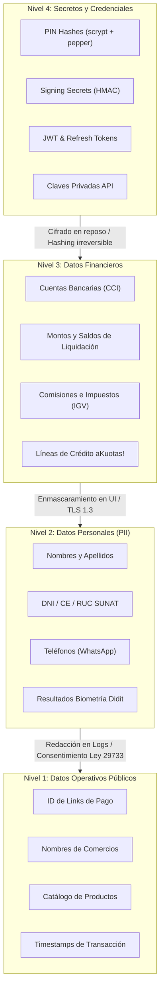

# Matriz de Roles, Permisos y Clasificación de Datos - Kuota

> **Commit de Referencia:** `d7bac8b329d817bd6cc39f4fae0e751bda319c5d`  
> **Rama:** `fix/proveedor-inicio-conciliacion`  
> **Fecha de Auditoría:** 14 de Noviembre de 2026

Este documento detalla la matriz de control de acceso basada en roles (RBAC) observada en el código fuente de Kuota, las fronteras multi-tenant, el mapa de clasificación de datos sensibles y las políticas de retención y sanitización.

---

## 1. Matriz CRUD de Roles y Recursos

A continuación se presenta la matriz de permisos observada en la implementación real de las rutas de Express y middleware de seguridad:

| Recurso / Entidad | Merchant (Emprendedor) | Provider (Proveedor) | Payer (Cliente Final) | Gateway (360Pay / Didit) | Admin / Sistema |
| :--- | :--- | :--- | :--- | :--- | :--- |
| **Perfil / Onboarding** | CRUD (propio) | CRUD (propio) | Sin acceso | R (solo webhook status) | CRUD (global) |
| **PIN / Credenciales** | RU (propio con rate limit) | RU (propio con rate limit) | Sin acceso | Sin acceso | Sin acceso (hash opaco) |
| **Sesiones / Tokens** | CR (mono-dispositivo) | CR (mono-dispositivo) | Sin acceso | Sin acceso | R (revocación forzada) |
| **Links de Pago (Cobros)** | CRU (anular propios) | CRU (anular propios) | R (pago público) | U (marca 'PAID' vía webhook) | CRUD (global) |
| **Ventas / Transacciones** | R (sus cobros) | R (sus cobros y pedidos) | R (su comprobante) | C (notificación webhook) | R (reportes globales) |
| **Pedidos aKuotas!** | C (solicita compra) | RU (despacha / confirma) | Sin acceso | Sin acceso | CRUD (evaluación crediticia) |
| **Cuenta Bancaria (CCI)** | RU (propia + Step-Up) | RU (propia + Step-Up) | Sin acceso | Sin acceso | R (auditoría / payouts) |
| **Ledger Contable** | R (saldo neto liquidado) | R (saldo neto liquidado) | Sin acceso | Sin acceso | CRUD (partida doble WORM) |
| **Bitácora de Auditoría** | Sin acceso | Sin acceso | Sin acceso | Sin acceso | R (solo lectura / anclaje) |

---

## 2. Realidad de Código vs Requisito de Diseño (Multi-Cajero vs Mono-Dispositivo)

### Brecha Arquitectónica Identificada
- **Requisito Declarado en Documentos de Producto:** Se contemplaba un esquema jerárquico de roles en punto de venta (Cajero, Supervisor, Administrador de Tienda) con permisos delegados por sucursal para generar links de cobro sin acceso a datos bancarios o liquidaciones.
- **Realidad Observada en Código (`auth.ts` / `providerPayments.routes.ts`):**
  1. **Mono-Dispositivo Forzado:** El método `revokeSessions(merchantId, { exceptDeviceId })` en `backend/src/security/auth.ts:L284-L299` cierra activamente cualquier sesión preexistente en cuanto se inicia sesión desde un nuevo terminal o dispositivo móvil. No es posible operar múltiples cajas concurrentes con la misma cuenta de comercio o proveedor.
  2. **Ausencia de Roles Granulares:** En base de datos solo existen dos tipos de sujetos autorizados a nivel comercial (`merchants` y `provider_profiles`). No existen tablas de usuarios delegados, cajeros ni sucursales.
  3. **Segregación a Nivel de Aplicación:** El aislamiento multi-tenant no se implementa mediante Row Level Security (RLS) en el motor de base de datos Postgres, sino filtrando explícitamente por `proveedor_id = req.user.id` o `merchant_id = req.user.id` en las cláusulas `WHERE` de las sentencias SQL preparadas.

---

## 3. Mapa de Clasificación de Datos

Los datos procesados y almacenados por Kuota se clasifican en cuatro niveles de criticidad:



### Tabla de Políticas de Protección y Retención de Datos

| Clasificación | Ejemplos de Campos | Cifrado en Reposo | Cifrado en Tránsito | Enmascaramiento / Redacción | Política de Retención |
| :--- | :--- | :--- | :--- | :--- | :--- |
| **Nivel 4: Secretos** | `pin_hash`, `webhook_secret`, `session_secret`, `token_hash` | Hash `scrypt` (`N=16384`) + HMAC pepper / SHA-256 / AES-256-GCM | TLS 1.3 obligatorio | **Totalmente redactado**: nunca viaja en logs (`[redacted]` en `audit.ts`) | Indefinido mientras la cuenta esté activa; revocado de inmediato al rotar. |
| **Nivel 3: Financieros** | `settlement_cci`, `amount_cents`, `fee_cents`, `approved_limit_cents` | Volumen cifrado (LUKS / Postgres TDE) | TLS 1.3 / mTLS | **Enmascarado parcial**: CCI muestra solo los últimos 4 dígitos (`mask(cci, 4)`) | 10 años conforme a exigencias normativas contables y tributarias SUNAT. |
| **Nivel 2: PII** | `legal_name`, `ruc`, `legal_rep_dni`, `whatsapp` | Cifrado a nivel de columna / volumen | HTTPS TLS 1.2+ | Visibilidad restringida al propietario y soporte autorizado | Conforme a Ley de Protección de Datos Personales de Perú (Ley 29733). |
| **Nivel 1: Operativos** | `link_id`, `concept`, `created_at`, `status` | Estándar de base de datos | HTTPS | Sin enmascaramiento requerido en pantalla de checkout | Retención histórica para reportería y conciliación (5 años). |

---

## 4. Salvaguardas en Bitácoras y Telemetría

Para asegurar que los registros de auditoría no se conviertan en un vector de fuga de información privilegiada:
1. **Filtro de Redacción Estricto (`REDACT`):**
   En `backend/src/security/audit.ts:L28-L35`:
   ```typescript
   const REDACT = new Set(['pin', 'current_pin', 'new_pin', 'access_token', 'step_up_token', 'token', 'secret']);
   ```
   Cualquier objeto de detalle que contenga estas claves es transformado automáticamente a `[redacted]` antes de ser insertado en `audit_log`.
2. **Inmutabilidad WORM:**
   La tabla `audit_log` dispone de triggers que rechazan operaciones `UPDATE` y `DELETE`, asegurando la no repudio de acciones de comercio o administración.
