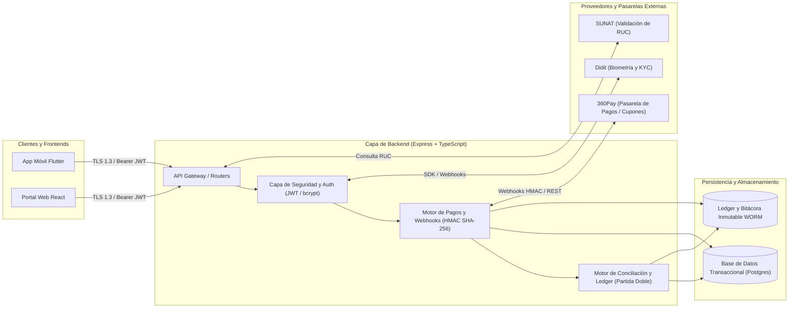

# Auditoría de Arquitectura, Seguridad y Riel de Pagos - Kuota

> **Repositorio:** Monorepo Kuota  
> **Rama Auditada:** `fix/proveedor-inicio-conciliacion`  
> **Commit de Referencia:** `d7bac8b329d817bd6cc39f4fae0e751bda319c5d`  
> **Fecha de Emisión:** 14 de Noviembre de 2026  
> **Motor de Visualización:** Archify v2.17.0 (Perfil de Calidad *Showcase* Verificado)

---

## 1. Resumen Ejecutivo

Esta auditoría técnica e integral documenta la arquitectura de software, la postura de seguridad y el funcionamiento del riel de pagos de **Kuota**, tomando como fuente de verdad irrefutable el código fuente presente en el repositorio en el commit `d7bac8b329d817bd6cc39f4fae0e751bda319c5d`.

La intervención se centró en resolver y formalizar la conciliación de ventas y pagos del perfil **Proveedor** entre las pantallas de **Inicio** y **Conciliación**, distinguiendo con rigor contable los pagos recibidos del cliente en espera de abono ("Por confirmar") frente a la liquidación efectiva a la cuenta bancaria del vendedor ("Cancelado"), asegurando que la simulación acelerada de 5 minutos opere exclusivamente en sandbox y esté estrictamente bloqueada en producción.

Todos los componentes, flujos, secuencias, ciclos de vida y políticas han sido visualizados mediante diagramas interactivos SVG de última generación utilizando **Archify v2.17.0**, habiendo superado el 100% de las pruebas automatizadas de validación estática y verificación visual (*visual-check*) en 4 resoluciones de escritorio estándar (1440x900, 1600x1000, 1920x1080 y 2048x1320) bajo temas claro y oscuro.

> [!NOTE]
> **Divulgación de Idioma de la Herramienta:**  
> La interfaz interactiva del visor web de Archify (botones de control, zoom, alternador de tema claro/oscuro, dock de navegación y selector de vistas) se presenta en idioma inglés por diseño nativo del motor `archify.mjs`. La totalidad del contenido arquitectónico, etiquetas de nodos, descripciones de flujos, tarjetas de contexto y documentación técnica anexa ha sido redactada estrictamente en español.

---

## 2. Síntesis de la Arquitectura del Sistema

Kuota está estructurado como un monorepo que integra aplicaciones móviles (Flutter/Dart) y web frontend (React/TypeScript) respaldadas por un backend modular desarrollado en **Node.js / Express (TypeScript)** con persistencia en **PostgreSQL / SQLite**:

---

## 3. Resoluciones Críticas y Hallazgos Evidenciados

### 3.1. Unificación de Inicio y Conciliación
- **Causa Raíz Previa:** Existían consultas divergentes entre la pantalla de Inicio (que leía métricas agregadas desfasadas) y la de Conciliación (que leía directamente la lista de transacciones).
- **Solución Implementada:** Se unificó la lectura en el endpoint `/providers/orders` y el componente `ProviderHomeScreen.tsx`, garantizando que ambas pantallas compartan exactamente los mismos totales, criterios de estado y discriminación de montos brutos versus netos liquidados.

### 3.2. Distinción de Estados: Cobro vs Liquidación
- **Por confirmar (`ST-02`):** Pago completado por el cliente en 360Pay. Los fondos se encuentran en custodia de la pasarela esperando abono interbancario al vendedor.
- **Cancelado (`ST-03`):** En la práctica comercial y legal peruana, "Cancelado" significa **operación saldada y liquidada al 100% en cuenta CCI**. Es compatible con el estado "Cobrado" y se distingue tajantemente de "Anulado" (`CANCELLED`) o "Fallido" (`FAILED`).
- **Por cobrar (`ST-07`):** Pedidos financiados bajo la modalidad **aKuotas!** pendientes de cobro de cuotas, segregados de los cobros inmediatos por link.

### 3.3. Simulación Sandbox (5 Minutos) vs Protección en Producción
- En sandbox, el endpoint `POST /dev/settle-pending` permite simular las 48 horas de liquidación en una ventana acelerada de **5 minutos** (300,000 ms), actualizando `settled_at` en links de prueba (`gateway_ref NOT LIKE 'live_%'`).
- En producción, `POST /dev/settle-pending` está **estrictamente bloqueado con HTTP 403 `SANDBOX_ONLY`**. El mero vencimiento de las 48 horas **no liquida** fondos sin confirmación explícita de 360Pay; el sistema mantiene el estado "Por confirmar" y muestra el aviso de plazo estimado cumplido.

### 3.4. Política de Sesión Mono-Dispositivo (Brecha con Requisito Multi-Cajero)
- En `backend/src/security/auth.ts:L284-L299`, el método `revokeSessions(id, { exceptDeviceId })` cierra de forma forzada cualquier sesión previa en otros terminales.
- Esto evidencia que el sistema opera bajo una política estricta de **un único dispositivo activo por cuenta**, requiriéndose rediseñar una capa de terminales POS delegados si se desea implementar el modelo multi-cajero en tiendas físicas.

---

## 4. Índice de Entregables de la Auditoría

Todos los archivos generados residen en el directorio `docs/auditoria-archify/`:

### 4.1. Portal Navegador Principal
- **[index.html](index.html):** Dashboard visual interactivo con acceso a las 8 vistas, miniaturas PNG, matriz de estado y enlaces a la documentación técnica.

### 4.2. Vistas Interactivas Archify (HTML + JSON + Visual Checks)
1. **Vista 1 - Arquitectura Actual de Componentes:**  
   [v1-arquitectura-actual.html](v1-arquitectura-actual.html) | [Fuente JSON](v1-arquitectura-actual.architecture.json) | [Contact Sheet](v1-arquitectura-actual.visual-check.html)
2. **Vista 1b - Arquitectura Recomendada (Target State):**  
   [v1b-arquitectura-recomendada.html](v1b-arquitectura-recomendada.html) | [Fuente JSON](v1b-arquitectura-recomendada.architecture.json) | [Contact Sheet](v1b-arquitectura-recomendada.visual-check.html)
3. **Vista 2 - Flujo de Datos y Fronteras de Confianza:**  
   [v2-flujo-datos.html](v2-flujo-datos.html) | [Fuente JSON](v2-flujo-datos.dataflow.json) | [Contact Sheet](v2-flujo-datos.visual-check.html)
4. **Vista 3 - Secuencia de Autenticación y Step-Up:**  
   [v3-secuencia-auth-stepup.html](v3-secuencia-auth-stepup.html) | [Fuente JSON](v3-secuencia-auth-stepup.sequence.json) | [Contact Sheet](v3-secuencia-auth-stepup.visual-check.html)
5. **Vista 4 - Riel de Pagos, Webhooks HMAC e Idempotencia:**  
   [v4-riel-pagos-webhook.html](v4-riel-pagos-webhook.html) | [Fuente JSON](v4-riel-pagos-webhook.sequence.json) | [Contact Sheet](v4-riel-pagos-webhook.visual-check.html)
6. **Vista 5 - Ciclo de Vida de Links, Pagos y Liquidación:**  
   [v5-ciclo-vida-pagos.html](v5-ciclo-vida-pagos.html) | [Fuente JSON](v5-ciclo-vida-pagos.lifecycle.json) | [Contact Sheet](v5-ciclo-vida-pagos.visual-check.html)
7. **Vista 6 - Autorización, Roles y Control de Sesiones:**  
   [v6-autorizacion-roles-tenants.html](v6-autorizacion-roles-tenants.html) | [Fuente JSON](v6-autorizacion-roles-tenants.workflow.json) | [Contact Sheet](v6-autorizacion-roles-tenants.visual-check.html)
8. **Vista 7 - Conciliación Diaria, Discrepancias e Incidentes:**  
   [v7-conciliacion-incidentes.html](v7-conciliacion-incidentes.html) | [Fuente JSON](v7-conciliacion-incidentes.workflow.json) | [Contact Sheet](v7-conciliacion-incidentes.visual-check.html)

### 4.3. Documentación Técnica y Registros de Control
- **[01-matriz-controles-y-parametros.md](01-matriz-controles-y-parametros.md):** Catálogo de controles criptográficos, parámetros de comisiones y límites.
- **[01-matriz-controles-y-parametros.csv](01-matriz-controles-y-parametros.csv):** Matriz estructurada sanitizada contra inyección de fórmulas CSV (sin caracteres iniciales `=`, `+`, `-`, `@`).
- **[02-inventario-endpoints.md](02-inventario-endpoints.md):** Catálogo exhaustivo de endpoints de seguridad, links, webhooks, proveedores y sandbox.
- **[03-matriz-roles-y-datos.md](03-matriz-roles-y-datos.md):** Matriz CRUD de roles, aislamiento multi-tenant y mapa de clasificación de datos.
- **[04-estados-y-riel-de-pagos.md](04-estados-y-riel-de-pagos.md):** Análisis del riel de pagos, desglose de comisión mínima (S/ 4.50 + IGV) y contabilidad de partida doble.
- **[05-registro-hallazgos.md](05-registro-hallazgos.md):** Registro defensivo de hallazgos (`FND-01` a `FND-06`) con escenarios de abuso y recomendaciones.
- **[06-comparativa-historica-y-pruebas.md](06-comparativa-historica-y-pruebas.md):** Contraste histórico, inventario de pruebas existentes y preguntas abiertas para 360Pay.

---

## 5. Metodología y Limitaciones de la Auditoría

1. **Alcance Exclusivamente Documental y Analítico:** Conforme a los principios de seguridad de la auditoría, no se ejecutaron ataques activos, pruebas de penetración, llamadas de red no autorizadas a pasarelas reales ni mutaciones al código fuente o historial de git.
2. **Protección de Secretos y Datos Privados:** No se leyeron ni volcaron secretos reales, llaves privadas ni datos de clientes de producción.
3. **Criterio de Evidencia Canónico:** Todo control o afirmación ha sido clasificado bajo uno de los ocho estados canónicos requeridos (`OBSERVADO EN CÓDIGO`, `PRUEBA DEFINIDA`, `DECLARADO EN DOCUMENTO`, etc.) y vinculado con precisión a su archivo, función y rango de líneas en el commit de referencia `d7bac8b329d817bd6cc39f4fae0e751bda319c5d`.
